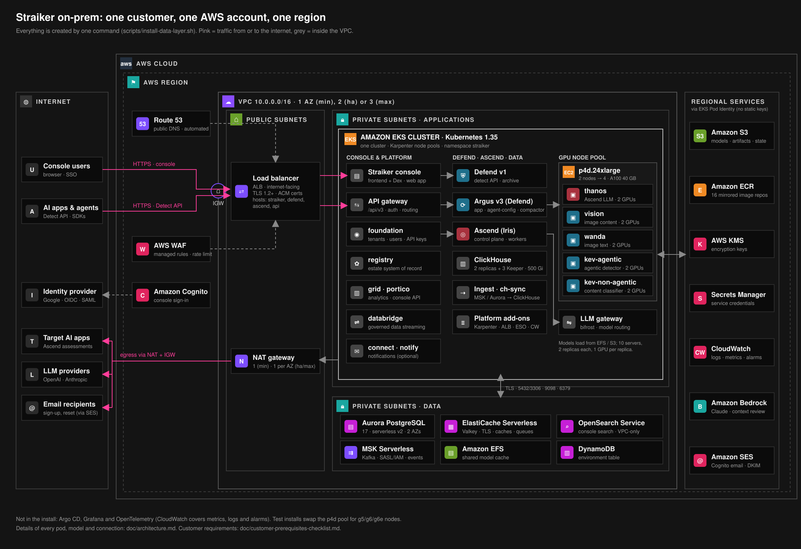
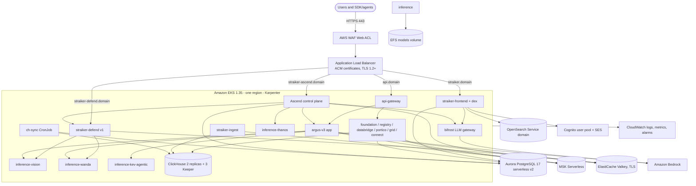
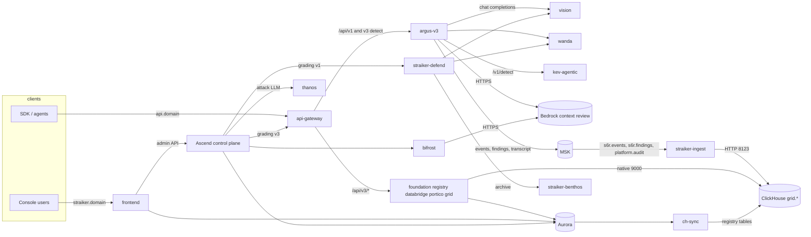

# Straiker on-prem architecture (AWS data-layer install)

What `scripts/install-data-layer.sh` builds in a customer's AWS account: the AWS services, every pod, every model, how they
connect, and their main settings. Sources: the Helm charts in `charts/`, the Terraform in `terraform/aws/*`, `scripts/install-straiker.sh`,
`doc/data-layer-install-runbook.md`, and the recorded state of the dl-test install (`~/.straiker/install.json`, read from the file only).
Versions are the ones pinned in the repo at the time of writing (`charts/image-tags.yaml`, chart `appVersion`).

> This replaces `onprem-architecture.md` in the repo root for the data-layer install: that older page describes the in-cluster
> Postgres/OpenSearch/Valkey mode, which the data-layer install no longer uses.

---

## 1. The whole picture

(`architecture-diagram.svg` is the source, `architecture-diagram.png` the same picture as an image; both are in `doc/`.) The same layout as a text diagram, for places that cannot show images:

Everything lives in **one AWS account and one region**. Nothing in the product needs inbound access except the load balancer on 443.

---

## 2. AWS services

| Layer | Service and settings | Created by |
|---|---|---|
| Network | VPC `10.0.0.0/16` (or your own), public and private subnets, IGW, NAT (1 for `min`, one per zone for `ha`/`max`), subnets tagged for load balancers and Karpenter | `terraform/aws/eks` |
| Cluster | EKS 1.35, public API by default (`--private-api-endpoint` available), add-ons: vpc-cni, coredns, kube-proxy, EBS CSI, EFS CSI, Pod Identity agent; system managed node group `m5.large`/`m5a.large`, tainted `CriticalAddonsOnly` | `eks` |
| Node scaling | Karpenter 1.14, SQS interruption queue, EventBridge rules, node IAM role | `eks`, `straiker-system` chart |
| Images and models | 16 ECR repositories `<prefix>/<image>`, versioned S3 models bucket, hauler and models-reader roles (Pod Identity, no static keys) | `terraform/aws/artifacts` |
| Relational | **One Aurora PostgreSQL cluster**, engine 17.x (newest in the region), serverless v2 2-16 ACU, writer + reader in two zones, port 3306, TLS, final snapshot `<cluster>-aurora-final`. Holds the databases foundation, registry, databridge, connect, notify, frontend, iris, bifrost | `terraform/aws/data` |
| Streaming | MSK Serverless (SASL/IAM, port 9098), topics in section 5 | `data` |
| Cache | ElastiCache Serverless Valkey (TLS 6379) for Argus and Defend; Ascend uses its own node-based Valkey replication group `<cluster>-iris-redis` | `data` |
| Search | Amazon OpenSearch Service domain (used by the console frontend), VPC-only (`min`: `t3.small.search` x1, 20 GB; `ha`: `r7g.large.search` x3 + 3 masters, 100 GB; `max`: `r7g.xlarge.search`, 200 GB) | `data` |
| Files | EFS for the shared models volume; DynamoDB table `<cluster>-environment`; grid artifacts S3 bucket | `data` |
| Secrets and keys | Secrets Manager under `<cluster>/...`, KMS key for data, External Secrets Operator syncs them into the cluster | `data`, `external-secrets` phase |
| Identity and mail | Cognito user pool with your identity provider federated in (Google, Facebook, Amazon, Apple, OIDC, SAML), Cognito domain `straiker-<cluster>`, SES domain identity (DKIM, mail-from) for the pool's email | `data` |
| Edge | ALB (internet-facing, `--edge-type xalb`), ACM certificates, **WAF** Web ACL `<cluster>-edge` (managed rule groups, per-IP rate limit 10000 per 5 min, per-host allowlists, body rules count rather than block), ExternalDNS and Route 53 records, AWS Load Balancer Controller | `terraform/aws/edge`, `edge` charts |
| Observability | CloudWatch Observability add-on (Container Insights with GPU metrics, Fluent Bit logs, 30-day retention), alarms to SNS topic `<cluster>-alarms` (nodes, CPU 85 %, memory 90 %, ALB 5xx, Aurora CPU 80 % and capacity 90 %) | `terraform/aws/observability` |
| AI provider | Amazon Bedrock through a dedicated IAM role (Pod Identity): Claude Haiku 4.5 and Sonnet 4.6 through a regional or global inference profile; Defend v3 also `global.openai.gpt-5.6-sol/-terra` | `artifacts`, installer |

---

## 3. Kubernetes: nodes

All NodePools are on-demand, Linux, AL2023, `expireAfter 720h` (the p4d pool is never expired), gp3 disks, IMDSv2 required. Subnets and security groups
are found by the tag `karpenter.sh/discovery: <cluster>`.

| NodePool | Arch / instances | Label and taint | Disk | Limit | Runs |
|---|---|---|---|---|---|
| system (managed node group) | `m5.large`, `m5a.large` | taint `CriticalAddonsOnly` | | | CoreDNS, controllers |
| straiker-shared | arm64 `m/c 6g/7g` large-xlarge | `purpose=general` | 50 Gi | 50 CPU | frontend, dex, bifrost, Defend, argus-v3, platform services, keepers, ingest |
| straiker-argus | arm64 `m/c 6g/7g` xlarge-4xlarge | `purpose=straiker-argus`, tainted | 50 Gi | 100 CPU | not used by the on-prem values |
| straiker-iris | arm64 `m/c 6g/7g` xlarge-2xlarge | `purpose=straiker-iris`, tainted | 50 Gi | 100 CPU | Ascend (control plane and workers) |
| straiker-clickhouse | arm64 `r6g/r7g.2xlarge` | `purpose=straiker-clickhouse`, tainted | 50 Gi | 32 CPU | ClickHouse servers |
| straiker-gpu | amd64. Customers: **`p4d.24xlarge`** (2 nodes for the fleet, grows to 4). Test installs: `g6e`/`g5`/`g6` one GPU per node | `purpose=argus-model-workers`, taint `nvidia.com/gpu` | 200 Gi, 3000 iops | 20 GPUs | the model servers; WhenEmpty after 1 h; can use a Capacity Reservation first |

---

## 4. Kubernetes: what runs (namespace `straiker`)

### Product services

| Pod | Image : tag | Replicas | Port | Requests / limits | Node pool |
|---|---|---|---|---|---|
| straiker-frontend (console) | `straiker/frontend:onprem-v2026.11.8-rc3` | 1 | 8080 | 250m, 256Mi / 1 CPU, 1Gi | general |
| dex (OIDC) | `dexidp/dex:v2.45.1` | 1 | 5556 | 100m / 500m | general |
| straiker-bifrost (LLM gateway) | `maximhq/bifrost:v1.6.7` | 1 | 8090 | 250m / 1 CPU | general |
| straiker-defend (Defend v1) | `straiker/argus:onprem-v2026.8.24` | 1 (+ settings-sync) | 8080 | 300m, 3Gi / 6Gi | general; PDB min 1 |
| argus-v3 (Defend v3): app, agent-config, compactor | `straiker/argus:v3-42f2001...` | app 2 (HPA 2-6), 1, 1 | 8080 (9090 metrics) | app 1 CPU, 4Gi | general |
| Ascend: control-plane, probe-worker, report-worker, recon-worker, cleanup CronJob (02:00), db-migrate | `straiker/iris:onprem-v2026.11.6.1` | 1 each | 8081 (MCP 8181) | 250m-500m, 256Mi-2Gi | iris |
| Jobs: frontend migrate and bootstrap | `frontend-migrate`, `postgres:16-alpine` | one-off | | | general |

### Platform services (all `v2026.11.3` except api-gateway)

| Service | Role | Replicas | Notes |
|---|---|---|---|
| api-gateway `v2.3.13-rc2` | public API, auth, routing to the services below | 1 | 8080, management 9090; reached through the ALB host `api.<domain>`; 1 CPU, 1Gi |
| foundation | tenants, users, roles, API keys | 1 | migrate Job |
| registry | agent and control catalog; also CDC source for ClickHouse | 1 | migrate and catalog-seed Jobs |
| databridge | api, ingest, reconcile, benthos delivery | 1 each | ingest only reachable in-namespace |
| portico | console-facing platform API | 1 | |
| grid | inventory, activity, insights queries over ClickHouse | 1 | migrate Job writes Replicated tables |
| connect | notifications (SES) | not installed by default | |

### Data pods inside the cluster

| Pod | Image | Replicas | Storage | Notes |
|---|---|---|---|---|
| clickhouse | `clickhouse/clickhouse-server:25.8` | 2 | 500 Gi gp3 each | request 7 CPU, 56 Gi; anti-affinity by node and zone; PDB max unavailable 1 |
| clickhouse-keeper | same image | 3 | 10 Gi each | ports 9181 client, 9234 raft |
| ch-sync (CronJob every minute) | same image | | | copies Aurora `registry` into ClickHouse `grid` as user `grid_sync` |
| straiker-ingest | `redpandadata/connect:4.101.0` | 1 | | reads MSK, batches 5000 rows or 1 s into ClickHouse over HTTP |
| straiker-benthos (archive) | `redpandadata/connect:4.101.0` | 1 | | HTTP `/archive` on 4195; writes each record to the **in-cluster OpenSearch** index named by its `stream` field (`turns`, `turns-flagged`, `turns-insights`, `iris`) |
| opensearch-cluster-master, postgres, valkey (from `straiker-system`) | `opensearch 3.6.0`, `postgres:16-alpine`, `valkey 8-alpine` | 1 each | OpenSearch 10 Gi, Postgres 20 Gi | still deployed in the data-layer install. Only OpenSearch is in use (archive target); on dl-test nothing was seen connecting to Postgres or Valkey, because the frontend and Ascend use Aurora and Defend/Argus use ElastiCache |
| straiker-data Jobs | `postgres:16-alpine`, `confluentinc/cp-kafka:7.7.1` | one-off | | create the databases and roles in Aurora; create the MSK topics (replication factor 3) |

ClickHouse users: `admin` (DDL), `grid_query_ro` (read, `readonly=2`), `grid_ingest` (insert on `grid.*`), `grid_purge`, `grid_sync` (select, insert, optimize, Postgres engine).

### Platform add-ons

AWS Load Balancer Controller, ExternalDNS, External Secrets Operator, Karpenter, NVIDIA device plugin (DaemonSet on GPU nodes, `RuntimeClass nvidia`), CloudWatch agent and Fluent Bit. Not part of the install: Argo CD, Grafana, OpenTelemetry.

---

## 5. Models

Five GPU model servers, **2 replicas each, one GPU per replica = 10 GPUs**. Each is its own Helm release `inference-<model>` (Deployment, Service `inference-<model>` port 8000 to container 8081, PDB min 1,
`RuntimeClass nvidia`). Weights come from S3 into a node cache before start (init container `model-cache-sync`); start-up can take up to 30 minutes.

| Model | Used for | Image | Served name | Settings | Called by |
|---|---|---|---|---|---|
| **thanos** | Ascend attack and grading LLM | `straiker/vllm:v0.27.0-5` | `thanos` | bf16, context 32768, GPU memory 0.90-0.95 (p4d 0.95), 24.5 GB weights | Ascend (`/v1/chat/completions`) |
| **vision** | image content (multimodal) | `straiker/vllm:v0.22.1` | `vision` | bf16, context 4096, GPU memory 0.75, fp8 KV cache, 1 image per prompt | argus-v3, Defend v1 |
| **wanda** | image text and detection (multimodal) | `straiker/vllm:v0.22.1` | `wanda` | bf16, context 4096, GPU memory 0.90, fp8 KV cache | argus-v3, Defend v1 |
| **kev-agentic** | agentic-behaviour classifier | `straiker/kev-lw-server:v0.2.2` (vLLM plus kev-server) | `kev-lw-4b-agentic` | context 9216, GPU memory 0.90, threshold 0.5, in-flight 32, queue 256, cache 20000 | argus-v3 (`/v1/detect`) |
| **kev-non-agentic** | 19-category content classifier | `straiker/vllm:v0.30.0` | `kev-4b-19cat` | bf16, context 32768, pooling/classify runner, eager mode | no caller wired in the charts yet |

Common vLLM settings: `--trust-remote-code`, `HF_HUB_OFFLINE=1`, probes on `/health`, termination grace 180 s, rolling update max unavailable 1.
GPU mapping: customers run all five on `p4d.24xlarge` (A100 40 GB, nothing quantized, thanos at 32k context); Straiker test installs use `--gpu-fleet per-model` (thanos on g6e L40S, vision/wanda/kev-non-agentic on g5 A10G, kev-agentic on g6 L4); VB test installs pin `g6e.4xlarge` (one L40S per node).
Planner estimates (`scripts/gpu-models.json`): thanos 24.5 GB weights, vision 4.5, wanda 9, kev-agentic 8.5, kev-non-agentic 8.5.

Defined in the charts but **not deployed**: antman, hulk, quicksilver, thor. Defend v1 still has endpoints for them, so the content-classifier detectors report "unavailable"; this is expected. A Bedrock LLM (`context-review`) covers the rest of Defend v3.

Model weights are copied once from Straiker's S3 (`onprem-artifact-models`) into the customer's bucket (`models/<model>/`), together with the images, by the `artifacts-sync` Jobs.

### MSK topics (created by the data Job; 6 partitions unless noted)

`s6r.events`, `s6r.findings`, `s6r.turns`, `s6r.defend_turns` (7 d), the matching `.dlq` topics (14 d), `platform.agent_config` and `platform.tenant_config` (compacted, infinite), `platform.audit` and `platform.audit.tenant` (7 d), `argus.transcript_events` (32 partitions, 7 d, 2 MiB messages), `argus.metrics`. Connect creates `notify.requested`.

---

## 6. How the pieces talk

| From | To | Protocol and what |
|---|---|---|
| Users | ALB, then WAF-filtered by host | HTTPS 443: `straiker.` frontend, `straiker-defend.` Defend, `straiker-ascend.` Ascend, `api.` api-gateway |
| api-gateway | argus-v3 | `/api/v1/detect`, `/api/v3/detect/**`, copilot webhooks |
| api-gateway | foundation, registry, grid, databridge, portico, connect | HTTP 80, by path (`/api/v3/...`) |
| argus-v3 | vision, wanda, kev-agentic | OpenAI-style `/v1/chat/completions`, kev `/v1/detect` |
| argus-v3 | MSK | produces `s6r.events`, `s6r.findings`, `argus.transcript_events`; consumes `platform.agent_config`, `platform.tenant_config`; compactor writes `s6r.defend_turns` and S3 |
| argus-v3, Defend v1 | ElastiCache Serverless | TLS 6379 |
| Ascend | ElastiCache replication group `<cluster>-iris-redis` | TLS 6379 |
| straiker-ingest | MSK to ClickHouse | `s6r.events` to `grid.raw_event`, `s6r.findings` to `grid.raw_finding`, `platform.audit` to `grid.audit_event` |
| foundation, registry, databridge, connect, frontend, Ascend | Aurora | PostgreSQL over TLS, one database each |
| foundation, registry, databridge, connect | MSK | SASL/IAM, port 9098 |
| ch-sync | Aurora `registry` to ClickHouse `grid` | every minute |
| frontend | Dex 5556, Ascend control plane, OpenSearch, Aurora | login, admin API, search |
| Ascend | thanos, bifrost, Defend v1 or api-gateway `/api/v3/detect` (v3 graders), Aurora, ElastiCache, benthos | attack generation and grading |
| bifrost | Bedrock (and OpenAI, xAI, Anthropic if keys are given) | HTTPS |
| Defend v1 | vision, wanda, benthos `/archive`, the frontend | detection, archive, foundation endpoint |
| straiker-benthos | in-cluster OpenSearch (not the managed domain) | archive writes, index per stream |
| Model pods | S3 models bucket / EFS | weights at start |

Secrets: all from Secrets Manager `<cluster>/...` through External Secrets into `straiker-secrets`, `platform-secret`, `straiker-db-dsn`,
`clickhouse-credentials`, `api-gateway-secrets`, the Aurora admin secret; pods reach AWS through **EKS Pod Identity**, never static keys.

---

## 7. Install order (phases)

`eks-tfbe` (state bucket), `eks-cluster`, `karpenter`, `k8s-preflight`, `aws-artifacts`, `gateway-cert`, `aws-data`, `external-secrets`, `artifacts-sync`
(mirror images and model weights), `straiker-system`, `shared-secrets`, `clickhouse`, `data-bootstrap`, `ch-sync`, `platform-services`, `ingest`, `verify-data-layer`,
`ai-provider-secrets`, `straiker-core`, `straiker-inference`, `straiker-defend`, `straiker-argus-v3`, `straiker-ascend`, then the edge (`edge-infra`, `alb-controller`, `external-dns`, `straiker-edge`) and `observability`.
Re-running the same command resumes at the first unfinished phase.

---

## 8. Reference installs

| | dl-test (Straiker test) | VB (customer-style test) | Customer |
|---|---|---|---|
| Region / zones | us-east-2, `us-east-2a,b` | us-west-2 | their region |
| Domain | `dltest.straiker.ai` | `vb.stage2.straiker.ai` | theirs |
| GPU | `per-model` fleet (g5/g6/g6e) | `g6e.4xlarge` x10 (stand-in for p4d) | **2 x `p4d.24xlarge`** (to 4) |
| Edge | ALB `xalb` with WAF, public gateway | same | same |
| Sign-in | Google | Google | their provider |
| Bedrock profile | regional (`us`) | regional (`us`) | regional or global |

The dl-test values above come from the recorded install state file, cross-checked read-only against the live cluster (section 10).

---

## 9. Things to know

- **kev-non-agentic has no caller** in the charts or installer: it runs (and costs two GPUs) but nothing uses it yet.
- **Gateway route name:** one api-gateway route points at `iris-control-plane-service`, but Ascend's Service is `straiker-ascend-control-plane`. Not yet verified at runtime; the route may not resolve.
- **Unavailable Defend detectors** (text classifier, prompt-kev, judge, groundedness, insecure-output, topic-relevance) are by design; the engine reports them as unavailable, not as failures.
- **api-gateway `v2.3.13-rc2`** carries the on-prem session authentication and is not yet on the api-gateway `main` branch.
- **No managed dashboards:** CloudWatch covers metrics, logs and alarms; Grafana, OpenTelemetry and Argo CD from the SaaS reference are not included.
- Customer requirements before running: `doc/customer-prerequisites-checklist.md`. Egress list: `doc/egress-allowlist.md`. Run, recover, tear down: `doc/data-layer-install-runbook.md`.

---

## 10. Live check of dl-test (read-only, 2026-11-16)

Compared this document with the running dl-test cluster (`kubectl get`, `helm get values`, environment variables without secrets). Nothing was changed.

- **Matches:** every Deployment, StatefulSet, CronJob and image tag in section 4, replica counts (all as listed, `argus-v3-app` 2 with HPA 2-6, ClickHouse 2, Keeper 3, each model 2), the five NodePools, four ALB Ingresses (`straiker.`, `straiker-defend.`, `straiker-ascend.`, `api.dltest.straiker.ai`, one shared ALB), Kubernetes v1.35.
- **GPU nodes (10, all us-east-2a):** vision 2 x g5.4xlarge, wanda 2 x g5.2xlarge, kev-non-agentic 2 x g5.2xlarge, kev-agentic 2 x g6.4xlarge, thanos 2 x g6e.4xlarge. System nodes also include one unmanaged-pool `m5.large` (the system node group).
- **Wiring confirmed:** frontend uses Aurora (port 3306, `sslmode=require`) and the managed OpenSearch domain; Ascend uses Aurora; Defend and Argus v3 use ElastiCache Serverless over TLS; Argus v3 talks to MSK Serverless on 9098.
- **Differences from the first draft:** the archive Benthos writes to the **in-cluster** OpenSearch; the in-cluster Postgres, Valkey and OpenSearch from `straiker-system` are still deployed next to the managed services. They are not removed by the data-layer install; turning off the unused ones would save a node's worth of memory but has not been tried.
- **Not observed:** no HPA other than `argus-v3-app`'s (its CPU metric shows `unknown`, so it will not scale on CPU until metrics-server answers).
